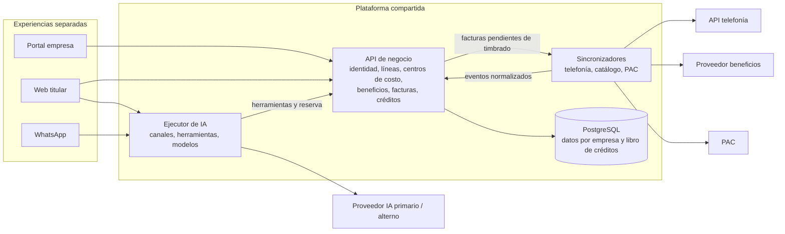
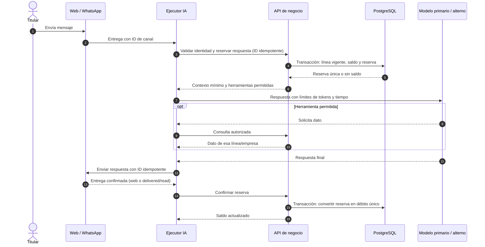

# Gege Tel · plataforma inicial

**Estado:** diseño y especificación inicial para un lanzamiento en ocho semanas con cuatro personas.

## 1. Alcance, supuestos y forma de trabajo

La plataforma atiende dos experiencias: un portal para empresas que administran líneas, centros de costo y facturación; y beneficios para titulares de línea por web y WhatsApp, incluido un asistente de IA. El directorio de líneas y consumo llega de telefonía, el catálogo de beneficios se consulta periódicamente porque no emite cambios y el timbrado se delega al PAC.

**Supuestos que deben confirmarse con negocio y proveedores:**

| Tema | Supuesto de arranque | Decisión pendiente |
| --- | --- | --- |
| Crédito | 1 crédito por respuesta completada y entregada: en WhatsApp se confirma con estado `delivered` o `read`, no con la aceptación de envío; reservar al iniciar. | Plazo máximo de espera del acuse, que se fija con el BSP en semana 1. |
| Periodo | Bolsa mensual por línea: 100 básico, 300 premium; el corte sigue el ciclo de la línea. | Zona horaria, prorrateo y cambios de plan a mitad del ciclo. |
| Identidad de línea | La relación entre teléfono, línea y empresa proviene de telefonía; un desafío de posesión vincula al usuario web/WhatsApp. | Calidad y frecuencia de la API de telefonía; portabilidad y números reciclados. |
| Facturación | El portal consulta, filtra por centro de costo, descarga XML/PDF e inicia corrección o cancelación; el PAC confirma el estado fiscal. | Fuente contable, permisos y validaciones fiscales exactas del PAC. |
| Beneficios | El catálogo se muestra con fecha de última sincronización y política de vencimiento. | SLA, límites de uso y derecho de redistribución del proveedor. |

**Arnés usado.** Codex, con el modelo GPT-6 de esta sesión, para analizar y redactar; OpenSpec 1.15.0 (`schema: spec-driven`) para capturar el cambio inicial; `AGENTS.md` para reglas locales. No se usaron subagentes ni se generó código: el trabajo era acotado y las decisiones de arquitectura se consultaron primero. La interacción real y las correcciones de alcance están en [evidencia/iteraciones.md](evidencia/iteraciones.md). El cambio está en [openspec/changes/lanzamiento-mvp](openspec/changes/lanzamiento-mvp) y sigue abierto porque aún no se construye el producto.

Para continuar: `npx --yes @fission-ai/openspec@1.15.0 status --change lanzamiento-mvp` y `npx --yes @fission-ai/openspec@1.15.0 validate lanzamiento-mvp --strict`. Se revisan requisitos y diseño antes de aplicar tareas; al implementar y verificar, se archiva el cambio y sus requisitos pasan a `openspec/specs/`.

## 2. Componentes y plataforma compartida

La **API de negocio** es dueña de identidad empresarial, membresías, líneas, asignaciones, centros de costo, facturas, solicitudes de corrección/cancelación, catálogo publicado y libro de créditos. Es la única que accede a PostgreSQL. Los dos productos comparten estas capacidades y contratos, pero conservan interfaces y permisos distintos. El **sincronizador** traduce e idempotentiza datos de proveedores y entrega cambios a la API; puede fallar o reintentarse sin bloquear el portal. El **ejecutor de IA** adapta web/WhatsApp, limita herramientas y modelos y solo obtiene datos mediante la API. Cada componente puede desplegarse y escalarse por separado; una base y contratos pequeños mantienen el alcance viable para cuatro personas.

No se incorpora bus de eventos, motor de agentes múltiples, búsqueda vectorial ni base por servicio en el lanzamiento. La API recibe operaciones idempotentes de integración; una cola gestionada solo se añadiría si los reintentos y picos medidos lo exigen. No se promete tiempo real para datos que los proveedores entregan por consulta.

En facturación, un rol autorizado inicia la solicitud en el portal y ve su historial y estado. Una corrección prepara un CFDI sustituto relacionado antes de pedir la cancelación del anterior; una cancelación registra el motivo y espera el resultado fiscal, que puede requerir aceptación del receptor. Ninguna solicitud cambia el estado a «cancelada» por el solo hecho de enviarse al PAC. La operación se audita y se concilia antes de reintentar una respuesta ambigua. El flujo concreto se valida con el PAC y el responsable fiscal. [SAT: proceso de cancelación](https://www.sat.gob.mx/minisitio/Factura/cancela_procesocancelacion.htm).

## 3. Aislamiento multiempresa y seguridad de IA

1. **Identidad antes de datos.** El portal obtiene una sesión de un proveedor de identidad y la API resuelve empresa y rol desde membresías internas. En web/WhatsApp, la API verifica posesión del número y vínculo vigente con una línea; nunca acepta una empresa indicada por cliente, webhook o modelo. Los cambios de titular o portabilidad revocan el vínculo anterior.
2. **API y base.** Toda consulta y mutación se autoriza por empresa, rol y recurso. Las tablas empresariales llevan `tenant_id`; las relaciones evitan referencias entre empresas. PostgreSQL aplica RLS con contexto de empresa fijado por transacción, rol de aplicación sin `BYPASSRLS` y `FORCE ROW LEVEL SECURITY` en tablas sensibles. El pool no conserva ese contexto entre solicitudes. Las cuentas de migración se separan de la cuenta de aplicación. Un identificador ajeno responde como uno inexistente; filtros, paginación, agregados y cachés también se acotan por empresa.
3. **Herramientas del asistente.** El ejecutor recibe identidad verificada y una lista corta de herramientas de solo lectura para MVP: consultar mis beneficios, mi consumo y mis créditos. Cada llamada a la API revalida línea y autorización; el modelo no puede modificar `tenant_id`, ejecutar SQL, llamar URLs arbitrarias ni obtener secretos. Los mensajes de proveedores son datos no confiables: sus instrucciones no alteran permisos. La memoria de conversación y sus claves de caché incluyen empresa y línea; no existe índice de recuperación compartido con datos privados.
4. **Verificación.** Antes de publicar, pruebas con dos empresas intentan cruzar IDs, roles, filtros, cachés, webhooks, llamadas de herramienta y prompts maliciosos. Se revisan logs y métricas para impedir que contenido, conteos o errores revelen datos ajenos. Se auditan accesos a facturas y créditos; los logs omiten texto sensible y tokens.

RLS aporta una barrera adicional, pero PostgreSQL documenta excepciones para propietarios, superusuarios y claves foráneas; por eso la autorización de API y las pruebas de aislamiento siguen siendo obligatorias. [PostgreSQL: Row Security Policies](https://www.postgresql.org/docs/current/ddl-rowsecurity.html). Los permisos mínimos para herramientas reducen el impacto de instrucciones maliciosas en contenido externo. [OWASP: Prompt Injection](https://genai.owasp.org/llmrisk/llm01-prompt-injection/).

## 4. Mensaje, resiliencia y gasto

El webhook de WhatsApp se autentica, se deduplica por ID de mensaje y se acusa recibo rápido; el procesamiento continúa fuera del tiempo límite del webhook. Web y WhatsApp llegan a la misma operación de reserva. La API comprueba vínculo activo, plan y saldo disponible, y crea una **reserva única** asociada a respuesta, línea y periodo en una transacción con bloqueo o actualización condicional. El saldo disponible descuenta reservas pendientes, por lo que dos mensajes concurrentes no gastan el mismo crédito. En web, la respuesta completa confirmada por el canal permite el débito; en WhatsApp se guarda el ID saliente y se espera el webhook `delivered` o `read`. `sent` o la aceptación inicial no cobran. Reintentos y eventos fuera de orden usan la misma clave y solo producen un débito. Si llega `failed` antes de la entrega o vence el plazo de reserva, se libera; si el acuse llega después del vencimiento, esa respuesta queda sin cargo. Una conciliación detecta reservas atascadas y acuses perdidos. Una respuesta de «sin saldo» no se cobra. Esta política favorece al titular pero expone gasto de IA sin ingreso; se limita con presupuestos y se mide en el piloto. [Meta: notificaciones de estado de mensajes](https://www.postman.com/meta/whatsapp-business-platform/request/rgtfq23/message-status-update-notifications).

Si el modelo principal cae a mitad del turno, el ejecutor conserva el ID de respuesta y la reserva. Para operaciones de lectura, intenta **una** continuación con el proveedor alterno dentro del mismo límite de tiempo y costo; no repite efectos externos. Si tampoco completa, informa de una indisponibilidad breve y libera la reserva. El historial que se envía al alterno se minimiza; la elección del proveedor requiere revisar privacidad y retención. En MVP el agente no tiene herramientas de escritura, lo que evita efectos duplicados.

El ejecutor registra tokens, costo estimado, latencia y errores por modelo, empresa y plan, sin almacenar texto sensible en métricas. Aplica topes por respuesta, por línea y por día. Ante gasto diario cercano al doble de su referencia **o** al presupuesto absoluto, activa degradación gradual: modelo más barato para consultas simples, menos herramientas/contexto, límites de concurrencia y cuota específica para la empresa o canal que dispara el gasto. Mantiene consultas deterministas de beneficios, saldo y facturas disponibles aunque pause temporalmente respuestas generativas. El presupuesto absoluto protege el arranque, cuando todavía no hay referencia histórica fiable; alertas y un interruptor por empresa permiten intervenir sin cortar a todos.

## 5. Ejecución en ocho semanas

**Cuatro responsables humanos:** producto/UX y aceptación; plataforma y seguridad; integraciones y facturación; IA/canales y observabilidad. Cada uno usa Codex sobre tareas delimitadas por OpenSpec; nadie delega al modelo aprobación de acceso, facturación o publicación. Una segunda persona revisa cambios en aislamiento y créditos. El equipo evita varios agentes simultáneos sobre el mismo contrato hasta que haya interfaces acordadas.

| Semanas | Resultado comprobable |
| --- | --- |
| 1 | Confirmar reglas de crédito, ciclo, identidad y contratos de proveedores; revisar OpenSpec y diagramas con negocio. |
| 2–3 | Sesión, membresías, tenant, RLS y portal mínimo de líneas/centros de costo; pruebas de dos empresas. |
| 3–4 | Sincronización de telefonía y catálogo con idempotencia, marcas de frescura y reconciliación. |
| 4–5 | Consulta/descarga de facturas y solicitudes de corrección/cancelación con estados PAC; web de titular y vínculo de número. |
| 5–6 | WhatsApp, herramientas de solo lectura, reservas/débitos y contingencia de modelo. |
| 7 | Pruebas de aislamiento, concurrencia de créditos, acuses tardíos, corrección/cancelación fiscal, gasto y fallos de proveedores. |
| 8 | Piloto de pocas empresas, correcciones, observación y decisión humana de salida. |

**Tres componentes usados ya hechos:** identidad gestionada para sesiones/MFA; servicio gestionado de PostgreSQL con copias y recuperación; proveedor oficial/BSP de WhatsApp para mensajería y webhooks. El PAC y los proveedores de telefonía, catálogo e IA son dependencias del escenario y se integran mediante contratos, sin reconstruirlos.

**Tres riesgos prioritarios:**

| Riesgo | Mitigación y señal de salida |
| --- | --- |
| Fuga entre empresas o por herramientas de IA | Autorización en API + RLS + herramientas acotadas; pruebas cruzadas de dos empresas y revisión humana sin hallazgos críticos. |
| Datos externos tardíos, incompletos o contradictorios | Sincronización idempotente, fecha de frescura visible, conciliación y estados pendientes; piloto con fallos simulados y contrato real. |
| Cobro duplicado o gasto de IA fuera de control | Libro de reservas, claves idempotentes, conciliación, presupuestos y degradación por empresa; pruebas concurrentes y alerta en piloto. |

La decisión de salida depende de demostrar estos controles con proveedores reales. Si una integración crítica no permite esa verificación en la semana 7, el piloto reduce su alcance en vez de simular que está lista.
