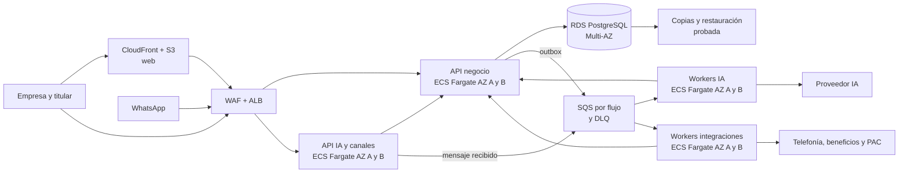
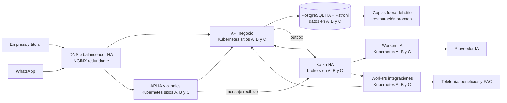

# Design

## Context

Dos productos comparten líneas, identidad, beneficios, facturación y créditos. El equipo tiene cuatro personas y ocho semanas. Los proveedores externos pueden entregar datos tarde o fallar. El [README principal](../../../README.md) muestra la arquitectura desde el usuario y la tecnología, el flujo gerencial del servicio y la secuencia de créditos.

## Decisions

1. **Tres componentes desplegables.** API de negocio, sincronizadores de proveedores y ejecutor de IA. Portal empresarial y web de titular son clientes separados. La API posee todos los datos empresariales y ofrece contratos a los otros componentes. Así pueden escalar y fallar por separado sin introducir un servicio y base por cada función.
2. **Una base, un dueño de acceso.** PostgreSQL sirve al MVP y solo la API de negocio abre conexiones. Cada fila empresarial se identifica por `tenant_id`. La API valida sesión, empresa, rol y recurso; RLS protege también consultas omitidas accidentalmente. El rol de aplicación carece de privilegios de bypass y las migraciones usan otro rol. El contexto de tenant se fija dentro de cada transacción, nunca en una conexión reutilizada.
3. **Integraciones por contratos idempotentes.** El sincronizador consulta telefonía y catálogo con cursores o marcas de tiempo disponibles y entrega a la API cambios normalizados con clave de proveedor. La API registra última actualización, errores y versión de origen. Para PAC, conserva estado pendiente hasta confirmar timbrado, corrección o cancelación y concilia respuestas ambiguas antes de repetir operaciones. La corrección relaciona CFDI sustituto y anterior; una cancelación registra motivo y puede requerir aceptación del receptor.
4. **Asistente con herramientas de lectura.** Web y WhatsApp se normalizan a una identidad de línea validada. El modelo solo propone llamadas a beneficios, consumo y saldo; la API autoriza cada llamada. Se separan instrucciones de sistema de texto del usuario y proveedor. No hay acceso directo a base, web abierta, herramientas de escritura, memoria entre empresas ni agentes múltiples.
5. **Créditos como libro transaccional.** La API reserva bajo bloqueo o actualización condicional del saldo para un ID de respuesta único. Reserva y débito pertenecen al mismo periodo de la línea. Web confirma la respuesta completa; WhatsApp confirma solo con `delivered` o `read` asociado al ID saliente. `sent` no cobra. Un fallo previo o el vencimiento libera; un acuse tardío no vuelve a cobrar. La conciliación resuelve reservas vencidas, eventos duplicados y estados inciertos.
6. **Contingencia y costo.** El ejecutor aplica límites de tokens, duración y gasto. Una falla del modelo permite un intento con alterno solo en operaciones de lectura y con la misma reserva. El presupuesto absoluto y la comparación contra gasto habitual activan degradación por empresa/canal antes de un corte global. Las consultas deterministas siguen operando.

## Tecnología y despliegue

**Decisión de alcance.** AWS y on premise son dos opciones para las mismas capacidades, no una migración prevista de una a otra. Se empaquetan API de negocio, API de IA y workers como contenedores; se puede escalar cada grupo por separado. La elección de framework backend y frontend queda abierta. Redis no es fuente de verdad y solo se añadiría si una medición demuestra necesidad de caché. PostgreSQL conserva el estado transaccional y un único escritor lógico.

**Dónde se usan eventos.** Las consultas del portal y la autorización de herramientas responden de forma síncrona; cada reserva o débito se ejecuta en una transacción de la API de negocio. Se encolan mensajes y acuses de WhatsApp, sincronización de proveedores, solicitudes al PAC y conciliación. El webhook responde solo después de que el transporte durable acepte el mensaje. El cambio de negocio y su intención de evento se escriben juntos en un *outbox* de la API; un publicador de esa misma API entrega el evento. Cada consumidor admite entrega al menos una vez, usa clave idempotente, reintentos acotados y una cola o tópico de errores revisable. Un reintento ambiguo de IA no vuelve a gastar tokens sin comprobar el estado y presupuesto de esa respuesta. El evento porta identificadores y versión de esquema; la API vuelve a resolver empresa y permisos al aplicar el resultado. El transporte no decide `tenant_id` ni sustituye al libro de créditos.

### Opción AWS · dos zonas de disponibilidad

CloudFront sirve la web; ALB distribuye las APIs entre tareas de ECS/Fargate en dos AZ. RDS PostgreSQL Multi-AZ mantiene un standby administrado en otra AZ. SQS separa los trabajos de los procesos web y usa DLQ para fallos repetidos. La restauración de copias y la pérdida de una región se tratan aparte: Multi-AZ cubre una zona, no una región. [ECS en múltiples AZ](https://docs.aws.amazon.com/AmazonECS/latest/developerguide/service-rebalancing.html), [RDS Multi-AZ](https://docs.aws.amazon.com/AmazonRDS/latest/UserGuide/Concepts.MultiAZSingleStandby.html), [entrega al menos una vez de SQS](https://docs.aws.amazon.com/AWSSimpleQueueService/latest/SQSDeveloperGuide/standard-queues-at-least-once-delivery.html).

### Opción on premise · tres dominios físicos

Aquí «sitio» significa un dominio físico independiente de energía, red y almacenamiento. Tres dominios sostienen el quórum de control de Kubernetes y Kafka y la disponibilidad de escritura de PostgreSQL tras perder uno. El tercer sitio necesita capacidad real de datos y broker; un testigo sin almacenamiento no equivale a otra AZ. Esta opción presupone conectividad de baja latencia, plataforma de Kubernetes y operación de base/broker ya disponibles; construirlas desde cero con cuatro personas en ocho semanas no es un supuesto válido. Las copias fuera del sitio y el ensayo de restauración siguen siendo necesarios. [Kubernetes en múltiples zonas](https://kubernetes.io/docs/setup/best-practices/multiple-zones/), [quórum Kafka](https://kafka.apache.org/35/operations/kraft/), [Patroni y réplica síncrona](https://patroni.readthedocs.io/en/latest/replication_modes.html).

| Decisión macro | AWS | On premise |
| --- | --- | --- |
| Entrada web/API | CloudFront, WAF y ALB | Balanceador y NGINX redundantes |
| Cómputo | Contenedores ECS/Fargate en dos AZ | Contenedores Kubernetes en tres sitios |
| Estado y eventos | RDS PostgreSQL Multi-AZ; SQS + DLQ | PostgreSQL/Patroni; Kafka con reintentos y tópico de errores |
| Operación | Servicios administrados; pruebas de conmutación y restauración propias | Quórum, parches, capacidad, guardias y recuperación operados por el equipo de infraestructura |

ECS/Fargate evita administrar nodos EC2 o un control plane EKS en el piloto. RDS PostgreSQL Multi-AZ es la referencia de datos en AWS; Aurora queda como alternativa si carga, recuperación y costo medidos la justifican. Kafka representa el broker on premise del diagrama, pero solo se fija si se necesita su retención/relectura y ya existe operación experta; una cola HA más simple puede cumplir el mismo contrato de trabajo asíncrono. SQS y Kafka no son intercambiables a nivel de API: las aplicaciones dependen de contratos de eventos y claves idempotentes, no de semánticas exclusivas de uno de ellos.

**Criterios aún abiertos:** objetivos RTO/RPO, volumen y picos por canal, región de AWS, ubicación y latencia de sitios, presupuesto de infraestructura, retención de eventos y capacidad real del equipo de operación. Ninguna opción se declara lista para producción sin probar pérdida de zona/sitio, redrive de eventos, conmutación de PostgreSQL y restauración de copias.

## Trust boundaries

| Límite | Validación al cruzarlo |
| --- | --- |
| Navegador empresarial → API | Sesión, membresía, rol, recurso y tenant. |
| Web/WhatsApp → ejecutor | Identidad de canal, deduplicación y vínculo de línea vigente mediante API. |
| Ejecutor/sincronizador → API | Identidad de servicio y operación permitida; nunca tenant libre elegido por modelo o evento. |
| API → PostgreSQL | Rol restringido, transacción con contexto de tenant, RLS, auditoría. |
| Proveedores → plataforma | Autenticidad, esquema esperado, límites, idempotencia y marcas de frescura. |

## Alternatives and consequences

- Bases propias por componente darían independencia de datos, pero añadirían sincronización distribuida y más operación antes del piloto. Se reconsideran si aparecen equipos y ciclos de despliegue realmente independientes.
- Un único proceso para todo simplificaría despliegue, pero acoplaría picos de IA y caídas de proveedores con el portal. Los tres componentes acordados aíslan estos fallos.
- Cobrar por token trasladaría variación de modelo al cliente y dificultaría entender la bolsa mensual. Se acordó un crédito por respuesta completada; el costo variable se controla internamente.

## Open questions

Validar con negocio el ciclo mensual, prorrateo, plazo máximo de reserva, expiración del catálogo y permisos para corregir/cancelar. Validar con PAC/SAT las reglas fiscales concretas y con el BSP la disponibilidad de `delivered`/`read`, reintentos, orden de eventos y retención. Estas respuestas pueden modificar la especificación antes de implementar.
